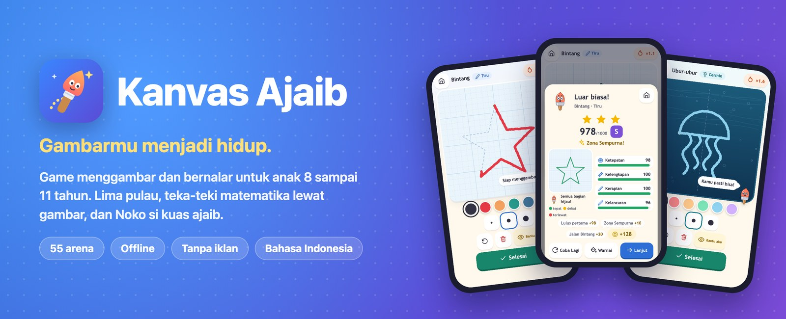
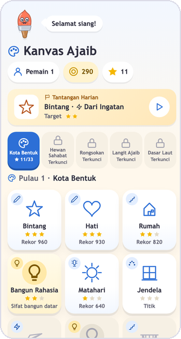
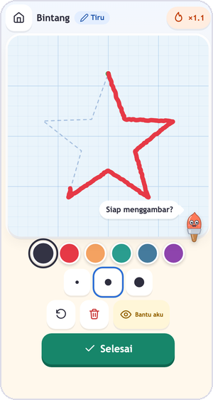
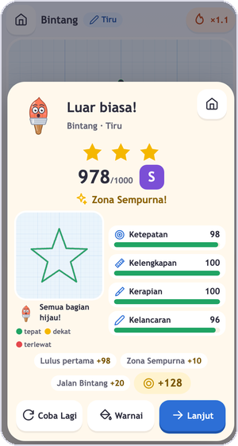
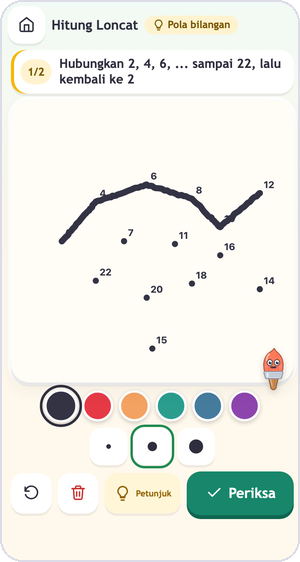
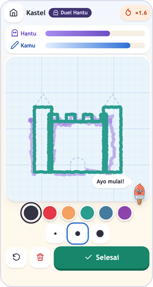
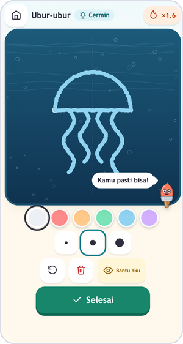
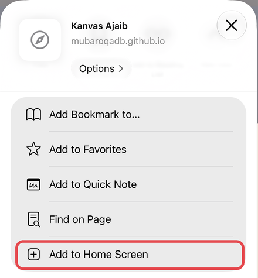
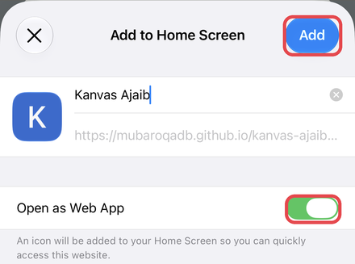
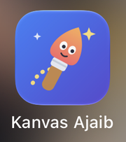

<p align="center">
  <a href="https://mubaroqadb.github.io/kanvas-ajaib/"></a>
</p>

<p align="center">
  <a href="https://mubaroqadb.github.io/kanvas-ajaib/"></a>
  <a href="https://github.com/mubaroqadb/kanvas-ajaib/actions/workflows/test.yml"></a>
  <a href="LICENSE"></a>
  
  
</p>

<p align="center">
  <b><a href="https://mubaroqadb.github.io/kanvas-ajaib/">Main di browser</a></b>
  &nbsp;·&nbsp; <a href="#pasang-di-hp-sebagai-game-offline">Pasang di HP</a>
  &nbsp;·&nbsp; <a href="#untuk-orang-tua-dan-guru">Orang tua dan guru</a>
  &nbsp;·&nbsp; <a href="CONTRIBUTING.md">Berkontribusi</a>
</p>

**Kanvas Ajaib** adalah game menggambar petualangan untuk anak **8 sampai 11 tahun**. Anak menggambar di lima
pulau bersama Noko si kuas ajaib, memecahkan teka-teki matematika lewat gambar, dan setiap gambar yang berhasil
**menjadi hidup**: ikan berenang, roket meluncur, matahari berputar. Gratis, tanpa iklan, tanpa akun, dan bisa
dimainkan tanpa internet.

## Sekilas

<table>
  <tr>
    <td align="center" width="33%"><br><b>Beranda</b><br><sub>Lima pulau, Tantangan Harian, Jalan Bintang</sub></td>
    <td align="center" width="33%"><br><b>Menggambar</b><br><sub>Goresan halus, Noko bereaksi langsung</sub></td>
    <td align="center" width="33%"><br><b>Hasil yang mengajar</b><br><sub>Peta ketepatan dan empat sub-skor</sub></td>
  </tr>
  <tr>
    <td align="center"><br><b>Tantangan Nalar</b><br><sub>Matematika dijawab dengan menggambar</sub></td>
    <td align="center"><br><b>Duel Hantu</b><br><sub>Adu gambar bersamaan di akhir pulau</sub></td>
    <td align="center"><br><b>Pulau Dasar Laut</b><br><sub>Mode Cermin di kertas laut</sub></td>
  </tr>
</table>

## Apa yang membuatnya berbeda

<table>
  <tr>
    <td width="50%" valign="top"><b>Tangga keterampilan</b><br>Bukan sekadar menjiplak. Anak naik dari Tiru ke Sambung Titik, Langkah demi Langkah, Kilat (menggambar dari ingatan), dan Cermin (simetri).</td>
    <td width="50%" valign="top"><b>Skor yang jujur</b><br>Coretan asal tidak pernah mendapat bintang. Skor menilai ketepatan, kelengkapan per bagian, kerapian, dan kelancaran garis.</td>
  </tr>
  <tr>
    <td valign="top"><b>Nalar lewat gambar</b><br>Sepuluh teka-teki: sifat bangun datar, simetri lipat dan putar, pola bilangan, koordinat, geser dan putar, pecahan, luas, dan keliling. Masing-masing punya tiga set soal.</td>
    <td valign="top"><b>Gagal tidak membuat buntu</b><br>Petunjuk bertahap, Mode Bantu setelah dua kali gagal, dan hantu yang melemah. Tanpa batas waktu yang memaksa.</td>
  </tr>
  <tr>
    <td valign="top"><b>Karya milik anak</b><br>Gambar hidup, Warnai dengan ember cat dan stiker, Buku Mewarnai, Kanvas Bebas, Galeri, dan Dinding Keluarga.</td>
    <td valign="top"><b>Ringan dan pribadi</b><br>Satu folder HTML, CSS, dan JavaScript tanpa dependensi. Semua data tersimpan di perangkat dan tidak dikirim ke mana pun.</td>
  </tr>
</table>

## Lima pulau

| Pulau | Kertas | Contoh gambar | Tantangan Nalar | Boss |
|---|---|---|---|---|
| **Kota Bentuk** | blueprint | Bintang, Rumah, Matahari, Menara | Bangun Rahasia, Lipat Cermin | Kastel |
| **Hewan Sahabat** | rumput | Ikan, Kucing, Kupu-kupu, Penguin | Hitung Loncat, Pola Berulang | Naga |
| **Rongsokan** | kraft | Mobil, Roket, Sepeda, Helikopter | Peta Koordinat, Geser dan Putar | Robot Raksasa |
| **Langit Ajaib** | langit malam | Pelangi, Lentera, Unicorn, Pegasus | Pecahan Warna, Luas Kotak | Phoenix |
| **Dasar Laut** | laut dalam | Ubur-ubur, Kuda Laut, Penyu, Paus | Simetri Putar, Keliling Pagar | Raja Gurita |

Setiap pulau berisi 8 level gambar, 2 Tantangan Nalar, dan 1 Duel Hantu: 55 arena seluruhnya.

## Pasang di HP sebagai game offline

Game ini bisa dipasang di layar utama HP atau tablet dan dimainkan tanpa internet, seperti aplikasi biasa.
Pasang dan buka sekali selagi tersambung internet; setelah itu semua berkas tersimpan di perangkat.

### iPhone dan iPad (Safari)

<table>
  <tr>
    <td align="center" valign="top" width="25%"><b>1. Buka menu</b><br><sub>Ketuk tombol menu di bilah alamat</sub><br><br></td>
    <td align="center" valign="top" width="25%"><b>2. Share</b><br><sub>Pilih Share (Bagikan)</sub><br><br></td>
    <td align="center" valign="top" width="25%"><b>3. Add to Home Screen</b><br><sub>Gulir, lalu pilih Tambahkan ke Layar Utama</sub><br><br></td>
    <td align="center" valign="top" width="25%"><b>4. Add</b><br><sub>Nyalakan Open as Web App, ketuk Add</sub><br><br><br><br></td>
  </tr>
</table>

Pada versi iOS yang lebih lama, tombol Share (kotak dengan panah ke atas) ada langsung di bilah bawah Safari.

<details>
<summary><b>Android (Chrome)</b></summary>

1. Buka https://mubaroqadb.github.io/kanvas-ajaib/ di Chrome.
2. Ketuk menu tiga titik di kanan atas.
3. Pilih **Instal aplikasi** (Install app). Bila tidak ada, pilih **Tambahkan ke layar utama** (Add to Home
   screen), lalu **Instal**.
4. Ikon Kanvas Ajaib muncul di layar utama dan daftar aplikasi.

</details>

<details>
<summary><b>iPhone dan iPad (Chrome)</b></summary>

1. Buka alamat game di Chrome.
2. Ketuk tombol **Share** (Bagikan) di bilah alamat.
3. Pilih **Add to Home Screen** (Tambahkan ke Layar Utama), lalu **Add**.

</details>

<details>
<summary><b>Laptop (Chrome atau Edge)</b></summary>

Klik ikon pasang di ujung kanan bilah alamat, lalu **Instal**.

</details>

<details>
<summary><b>Catatan penting</b></summary>

- Progres permainan tersimpan di perangkat. Di iPhone dan iPad, aplikasi di layar utama punya simpanan sendiri
  yang terpisah dari Safari, jadi progres yang dibuat di tab Safari tidak ikut pindah.
- Untuk memindahkan progres antarperangkat, buka **Keluarga**, lalu **Laporan Orang Tua/Guru**, lalu
  **Cadangkan profil**. Di perangkat lain, buka menu yang sama dan pilih **Pulihkan dari cadangan**.
- Pembaruan game terunduh otomatis saat aplikasi dibuka selagi tersambung internet.

</details>

## Untuk orang tua dan guru

- **Profil keluarga:** sampai 4 anak di satu perangkat, masing-masing dengan progres, koin, dan galerinya
  sendiri, plus Papan Keluarga.
- **Laporan Orang Tua/Guru** (di balik soal perkalian sederhana): waktu bermain, tren skor, rata-rata empat
  sub-skor, ingatan visual, simetri, kelancaran goresan, dan penalaran per topik.
- **Ekspor CSV** catatan percobaan dan cadangan JSON profil. Bila data dipakai untuk penelitian, diperlukan
  persetujuan orang tua dan izin etik lembaga.

## Menjalankan dan menguji

Buka `index.html` langsung di browser, atau sajikan folder ini dengan server statis apa pun
(misalnya `python3 -m http.server`). Lewat http/https, game bisa dipasang sebagai aplikasi dan berjalan offline.

```
npm test
```

Menjalankan empat paket uji Node: skor gambar, seni dan audio, penilai Nalar, dan konten. Uji yang sama berjalan
otomatis di GitHub Actions pada setiap push dan pull request.

## Berkontribusi

Masukan dan perbaikan sangat diterima, baik dari guru dan orang tua maupun pemrogram. Laporkan bug atau usulkan
level dan teka-teki lewat [isu](../../issues), atau kirim pull request. Baca [CONTRIBUTING.md](CONTRIBUTING.md)
dan [dokumen desain](docs/GAME-DESIGN.md) lebih dulu.

## Lisensi

Kode dilisensikan di bawah [MIT](LICENSE). Dokumentasi di `docs/` dilisensikan di bawah
[CC BY 4.0](docs/LICENSE.md).
