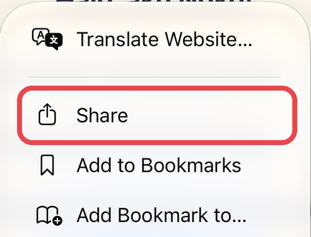

# Kanvas Ajaib

Game menggambar petualangan untuk anak 8 sampai 11 tahun. Anak menggambar di lima pulau, memecahkan teka-teki
nalar matematis lewat gambar, dan setiap gambar yang berhasil menjadi hidup.

**Main sekarang:** https://mubaroqadb.github.io/kanvas-ajaib/

## Isi

- 55 arena di 5 pulau: level gambar (Tiru, Titik, Langkah, Kilat, Cermin), Tantangan Nalar, dan Duel Hantu.
- Tantangan Nalar: sifat bangun datar, simetri lipat dan putar, pola bilangan dan bentuk, koordinat,
  transformasi, pecahan, luas, dan keliling. Setiap teka-teki punya tiga set soal.
- Tantangan Harian, Buku Mewarnai, Kanvas Bebas, Galeri, dan Dinding Keluarga.
- Profil keluarga (sampai 4 anak) dan laporan untuk orang tua atau guru, dengan ekspor CSV.

## Pasang di HP sebagai game offline

Game ini bisa dipasang di layar utama HP atau tablet dan dimainkan tanpa internet, seperti aplikasi biasa.
Pasang dan buka sekali selagi tersambung internet; setelah itu semua berkas tersimpan di perangkat.

### iPhone dan iPad (Safari)

1. Buka https://mubaroqadb.github.io/kanvas-ajaib/ di Safari.
2. Ketuk tombol menu di bilah alamat, lalu pilih **Share** (Bagikan). Pada versi iOS yang lebih lama, tombol
   Share (kotak dengan panah ke atas) ada langsung di bilah bawah Safari.

   

   
3. Gulir daftar lalu pilih **Add to Home Screen** (Tambahkan ke Layar Utama).

   
4. Pastikan **Open as Web App** menyala, lalu ketuk **Add** (Tambah).

   
5. Ikon Kanvas Ajaib muncul di layar utama. Buka dari ikon itu.

### Android (Chrome)

1. Buka https://mubaroqadb.github.io/kanvas-ajaib/ di Chrome.
2. Ketuk menu tiga titik di kanan atas.
3. Pilih **Instal aplikasi** (Install app). Bila tidak ada, pilih **Tambahkan ke layar utama** (Add to Home
   screen), lalu **Instal**.
4. Ikon Kanvas Ajaib muncul di layar utama dan daftar aplikasi.

### iPhone dan iPad (Chrome)

1. Buka alamat game di Chrome.
2. Ketuk tombol **Share** (Bagikan) di bilah alamat.
3. Pilih **Add to Home Screen** (Tambahkan ke Layar Utama), lalu **Add**.

### Laptop (Chrome atau Edge)

Klik ikon pasang di ujung kanan bilah alamat, lalu **Instal**.

### Catatan

- Progres permainan tersimpan di perangkat. Di iPhone dan iPad, aplikasi di layar utama punya simpanan
  sendiri yang terpisah dari Safari, jadi progres yang dibuat di tab Safari tidak ikut pindah.
- Untuk memindahkan progres antarperangkat, buka **Keluarga**, lalu **Laporan Orang Tua/Guru**, lalu
  **Cadangkan profil**. Di perangkat lain, buka menu yang sama dan pilih **Pulihkan dari cadangan**.
- Pembaruan game terunduh otomatis saat aplikasi dibuka selagi tersambung internet.

## Menjalankan

Buka `index.html` langsung di browser, atau sajikan folder ini lewat server statis apa pun. Lewat http/https,
game bisa dipasang sebagai aplikasi (PWA) dan berjalan offline.

Tanpa dependensi, tanpa akun, tanpa iklan. Semua data tersimpan di perangkat.

## Uji

```
npm test
```

Menjalankan empat paket uji Node (skor gambar, seni dan audio, penilai Nalar, konten). Uji yang sama berjalan
otomatis di GitHub Actions.

## Berkontribusi

Masukan dan perbaikan sangat diterima, baik dari guru dan orang tua maupun pemrogram. Laporkan bug atau usulkan
level dan teka-teki lewat [isu](../../issues), atau kirim pull request. Baca [CONTRIBUTING.md](CONTRIBUTING.md)
dan [dokumen desain](docs/GAME-DESIGN.md) lebih dulu.

## Lisensi

Kode dilisensikan di bawah [MIT](LICENSE). Dokumentasi di `docs/` dilisensikan di bawah
[CC BY 4.0](docs/LICENSE.md).
